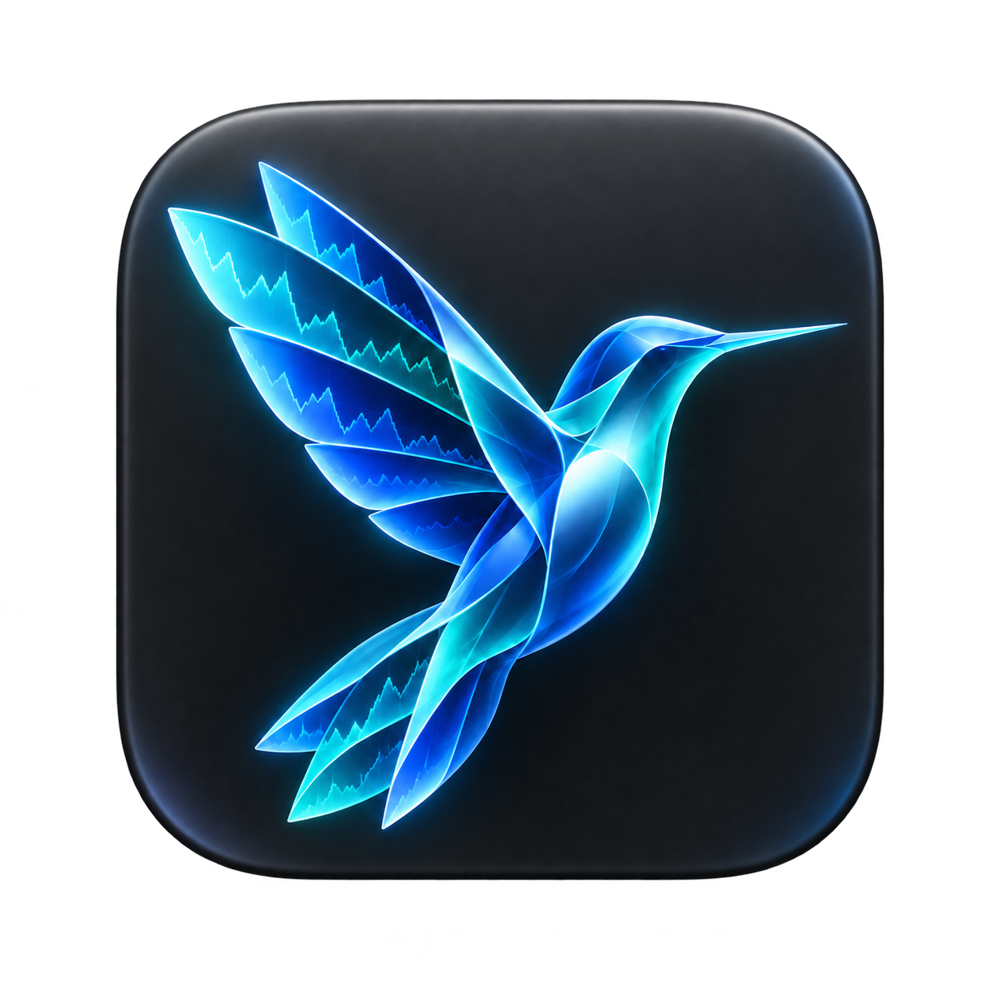
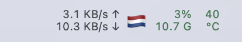
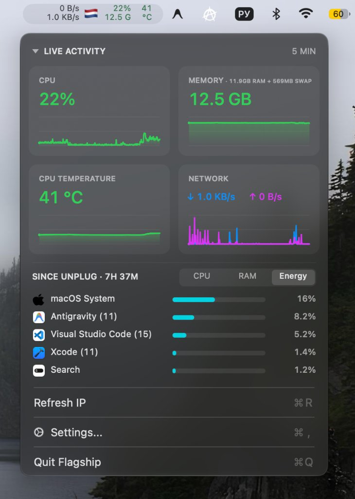
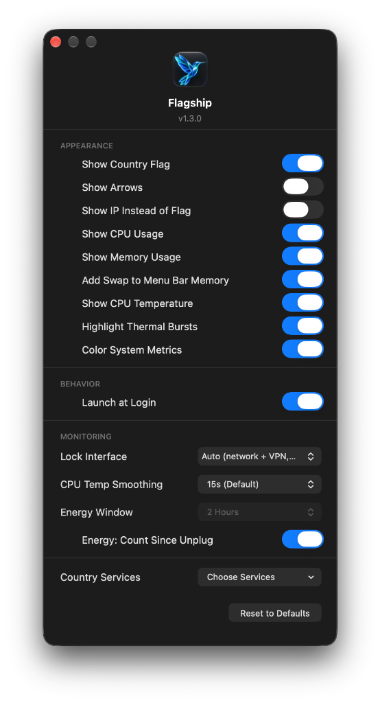

<div align="center">
  
  <h1>Flagship</h1>

  <p>
    <a href="https://github.com/BeNDYGo/Flagship/releases"></a>
    <a href="https://www.apple.com/macos/"></a>
    
    <a href="https://swift.org"></a>
    <a href="LICENSE"></a>
  </p>

  <p>
    <a href="README.md">English</a> |
    <a href="README-RU.md">Русский</a> |
    <a href="README-ZH.md">简体中文</a> |
    <b>日本語</b>
  </p>

  <p>
    <b>Flagship</b> は、macOS のメニューバーに常駐する軽量で高機能なシステムモニターアプリです。リアルタイムのネットワークアクティビティと、主要なシステム指標（CPU 負荷、メモリ使用量、CPU 温度）をコンパクトに統合して表示します。
  </p>

  <p>
    
  </p>
</div>

|  |  |
| --- | --- |
|  |  |


## 主な機能

- **コンパクトなメニューバー表示**: アップロード / ダウンロード速度、国旗 / 外部 IP、CPU 使用率、使用中メモリ、CPU 温度を 2 行でスマートに表示。
- **ポップアップダッシュボード**: 各指標の直近 5 分間の推移をスパークライングラフで表示（CPU、メモリ、温度、統合ネットワークグラフ）。
- **国旗と外部 IP の自動取得**: 外部 IP の地理的位置を自動判別して国旗を表示。ネットワークや VPN の切り替えにも瞬時に追従。
- **負荷に応じたカラー表示**: 負荷レベルに応じて色分け表示（緑・黄・赤）。macOS のライトモードおよびダークモードの両方に最適化。
- **柔軟なカスタマイズ**: 不要な指標の非表示（ネットワークのみ、またはシステム情報のみの表示）、特定ネットワークインターフェースへの固定、Geo-IP プロバイダーの選択が可能。
- **極めて低いリソース消費**: Swift/AppKit 製のネイティブアプリ。重い外部依存関係を持たず、SMC センサーおよび Mach カーネル統計を直接読み込み。

---

## インストール方法

### 動作環境
- macOS 13.0 (Ventura) 以降。
- Apple Silicon (M1/M2/M3/M4) および Intel (x86_64) 対応の Universal バイナリ。

### ビルド済みアプリのダウンロード
1. [Releases](https://github.com/BeNDYGo/Flagship/releases) ページから `Flagship.zip` をダウンロードします。
2. アーカイブを展開し、`Flagship.app` を `/Applications`（アプリケーション）フォルダに移動します。
3. アプリを起動すると、メニューバーにインジケーターが表示されます。
4. インジケーターをクリックするとダッシュボードが開き、メニューの **Settings...** から外観のカスタマイズや **Launch at Login**（ログイン時の自動起動）を設定できます。

> **初回起動時の注意（macOS Gatekeeper について）:**  
> 本アプリはローカル ad-hoc 署名が施されているため、初回起動時に macOS から未確認の開発者に関する警告が表示される場合があります。
>
> 以下の 3 つの方法のいずれかで起動できます：
> 1) Finder で `Flagship.app` を右クリック（または Control キーを押しながらクリック）し、「**開く**」を選択します。
>
> 2) 上記で開けない場合：「**システム設定**」→「**プライバシーとセキュリティ**」を開き、下部の「**セキュリティ**」セクションで「**このまま開く**」をクリックします。
>
> 3) または、ターミナルで以下のコマンドを実行します：  
> ```sh
> xattr -cr /Applications/Flagship.app
> ```

---

## ソースコードからのビルド

本アプリを自分でビルドする場合は、Xcode Command Line Tools が必要です。

1. リポジトリをクローンします：
   ```sh
   git clone https://github.com/BeNDYGo/Flagship.git
   cd Flagship
   ```
2. ビルドスクリプトを実行します：
   ```sh
   ./build.sh
   ```

このスクリプトは `arm64` および `x86_64` 向けの Universal バイナリをコンパイルし、アプリをパッケージ化して ad-hoc 署名を行います。生成物は `build/Flagship.app` に出力されます。

---

## 技術仕様とアーキテクチャ詳細

1. **メニューバーのタイポグラフィとレイアウト**: 数値変動による幅のブレを防ぐため、9.5 pt regular の等幅数字フォント（`monospacedDigitSystemFont`）を採用。自動縮小は無効化されており、数値が一桁やゼロになっても確保された表示幅を維持します。一部の指標を非表示にした場合も、残りの項目が自動的に中央揃えされます。
2. **カラー閾値（Color System Metrics）**: 有効時、CPU は 50% まで通常色、50% 以上でオレンジ、80% 以上で赤。メモリは 70% まで通常色、70% 以上で警告、90% 以上で危険。CPU 温度は 70°C まで通常色、70°C 以上で警告、90°C 以上で危険色となります。ライト / ダークモードの両方で十分なコントラストが得られる配色設計です。ネットワーク速度は常にシステム標準のモノクロを保ちます。
3. **バックグラウンドでのリソース計測**: すべての計測はメイン UI スレッドをブロックせず、専用のシリアルバックグラウンドキュー `flagship.system`（`qos: .utility`）上で 1 秒ごとに実行されます。
4. **メモリ使用量の計算式**: 使用中メモリは `host_statistics64` より `active + wired + compressed` として算出（1 GB = 1024³ バイト）。抽象的な memory pressure ではなく、物理的に専有されている実メモリ量を正確に反映します。
5. **CPU 温度の計測**: IOKit 経由で `AppleSMC` ドライバから直接読み取ります。値は現在のサンプルにおけるすべての利用可能な CPU コア熱センサーの算術平均値です（Apple Silicon および Intel に対応）。センサーが利用できない環境（仮想マシンなど）ではハイフン（-）が表示されます。
6. **ネットワーク集計と VPN 処理**: Auto（自動）モード時、物理インターフェース（`en*`、`pdp_ip*`）のみを集計します。仮想トンネル（`utun*`）のトラフィックは、すでに物理アダプタを通過しているため合算から除外され、VPN 接続時の二重カウント（速度の倍増）を防ぎます。特定の `utun*` に手動で固定した場合は、そのトンネルのみのトラフィックを計測します。
7. **速度計測の精度**: 固定の 1 秒周期を仮定せず、前回の計測時からの差分バイト数を実際の経過時間（`uptimeNanoseconds`）で除算して算出します。新しいインターフェースが検出された際は、まず基準スナップショットを取得することで、起動直後の異常なスパイクを防ぎます。固定インターフェースが切断された場合、速度は即座にゼロになります。
8. **ネットワーク変更の検知**: `SCDynamicStore`（IPv4/IPv6 グローバルルーティング、サービス状態、リンク状態の変化）、`NWPathMonitor`、1 秒ごとのアドレスポーリング、およびシステム復帰イベント（`didWakeNotification`）を組み合わせて追従します。
9. **Geo-IP のフェイルオーバーと再試行**: ネットワーク変更を検知すると直ちに問い合わせを実行し、VPN の遅延ルーティングを確実に捕捉するため 1 秒後および 3 秒後に検証の再試行を行います。5 つのプロバイダー（`ip-api.com`、`ipapi.co`、`api.country.is`、`ipinfo.io`、`ipwho.is`）に対応し、HTTP 429 および `Retry-After` ヘッダーを適切に処理します。取得中またはサービス障害時は白旗 🏳️ が表示されます。
10. **データ保持と設定の分離**: 5 分間のグラフ履歴データは揮発性メモリ（RAM）上のみに保持され、アプリの再起動時にリセットされます。設定情報は専用のドメイン `local.flagship.app` に保存されるため、他のツールと競合しません。

---

## 開発元とライセンス

- ベースプロジェクト: [NetBar](https://github.com/mh-sudo) (MIT License)。
- ライセンス: MIT。
