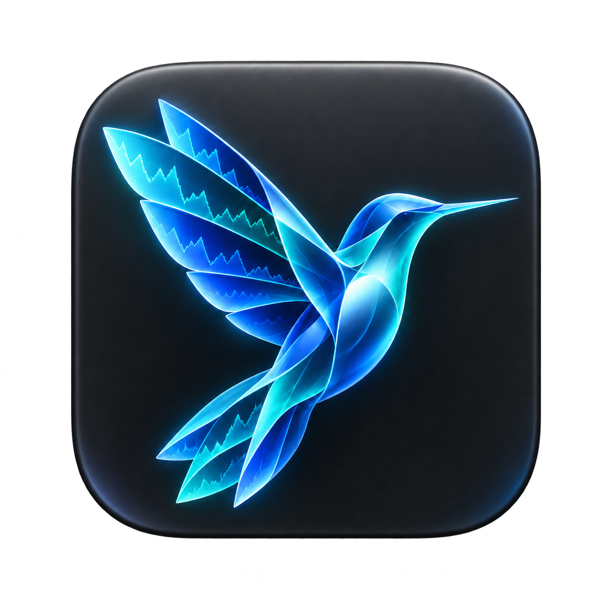
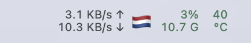
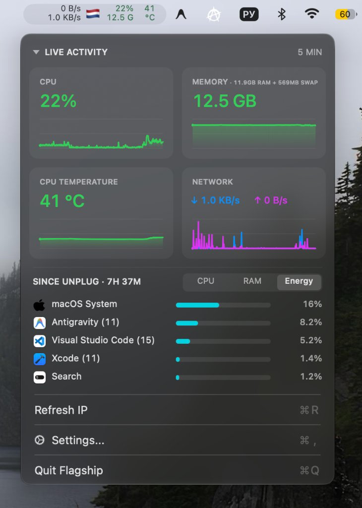
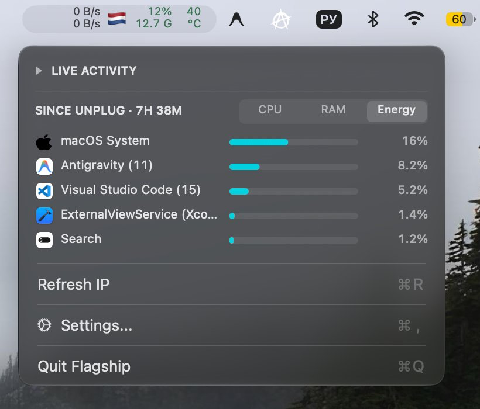
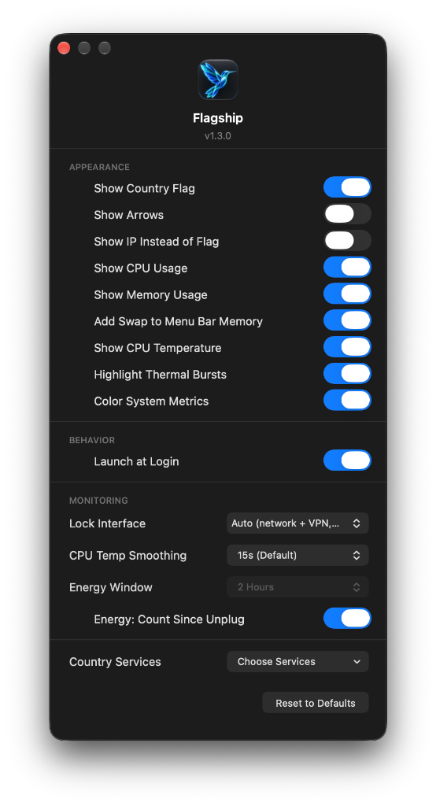

<div align="center">
  
  <h1>Flagship</h1>

  <p>
    <a href="https://github.com/BeNDYGo/Flagship/releases"></a>
    <a href="https://www.apple.com/macos/"></a>
    
    <a href="https://swift.org"></a>
    <a href="LICENSE"></a>
    <a href="https://github.com/USER/REPO">
  </p>

  <p>
    <a href="README.md">English</a> |
    <b>Русский</b>
  </p>

  <p>
    <b>Flagship</b> — системный монитор для строки меню macOS. Приложение объединяет сетевой монитор в реальном времени, системные метрики (загрузка процессора, оперативная память со Swap, температура CPU) и детальный трекер активности и энергопотребления процессов.
  </p>

  <p>
    
  </p>
</div>

| Полный дашборд | Компактный режим (Live Activity свернут) | Настройки Flagship |
| :---: | :---: | :---: |
|  |  |  |


## Основные возможности

- **Компактный индикатор в строке меню**: двухстрочное отображение текущей скорости отдачи и загрузки, флага страны / внешнего IP, загрузки CPU, объема занятой памяти (с опциональным учетом Swap) и температуры.
- **Всплывающий дашборд с графиками**: история за последние 5 минут для каждого показателя (CPU, RAM, температура и объединенный график сети).
- **Сворачиваемый блок Live Activity**: возможность одним кликом свернуть сетку графиков, переключив дашборд в компактный режим со списком активных процессов.
- **Мониторинг процессов и расхода батареи**: отслеживание самых ресурсоемких приложений по CPU, RAM и энергии. Вкладка **Energy** и режим **Since Unplug** отображают процент разряда батареи каждым приложением с момента отключения от питания с автоматической группировкой системных демонов macOS.
- **Определение страны и внешнего IP**: автоматическое определение геолокации внешнего адреса с отображением флага, мгновенная реакция на переключение сети и VPN.
- **Цветовая индикация нагрузки**: настраиваемая подсветка системных метрик в зависимости от уровня нагрузки (зелёный, жёлтый, красный) с поддержкой светлой и тёмной тем macOS.
- **Гибкая кастомизация**: возможность скрывать любые индикаторы, закреплять мониторинг на конкретном интерфейсе, включать сглаживание температурных скачков (CPU Temp Smoothing), подсвечивать тепловые всплески и выбирать провайдеров гео-IP.
- **Минимальное потребление ресурсов**: нативное приложение на Swift/AppKit, прямое чтение сенсоров SMC и статистики ядра Mach без сторонних зависимостей.

---

## Установка

### Требования
- macOS 13.0 (Ventura) или новее.
- Поддерживаются Apple Silicon (M1/M2/M3/M4) и Intel (x86_64).

### Загрузка готовой версии
1. Скачайте образ `Flagship.dmg` (или архив `Flagship.zip`) со страницы [Releases](https://github.com/BeNDYGo/Flagship/releases).
2. Откройте `Flagship.dmg` и перетащите `Flagship.app` в папку `/Applications`.
3. Запустите приложение. В строке меню появится индикатор.
4. По клику на индикатор открывается дашборд. В меню доступен пункт **Settings...**, где можно настроить внешний вид и включить **Launch at Login** (автозапуск при входе).

> **Примечание при первом запуске (Gatekeeper):**  
> Поскольку сборка подписана локальной ad-hoc подписью без платного сертификата Apple Developer, при первом открытии macOS может предупредить о неизвестном разработчике.
>
> **Способы открыть приложение:**
> 1) Выполните в Терминале (быстрый и надежный способ для всех версий, включая macOS 15 Sequoia):  
> ```sh
> xattr -cr /Applications/Flagship.app
> ```
> 2) Либо откройте **Системные настройки** → **Конфиденциальность и безопасность** (Privacy & Security) → пролистайте вниз до раздела **Безопасность** (Security) и нажмите **Открыть в любом случае** (Open Anyway).
> 3) В старых версиях macOS: нажмите на `Flagship.app` правой кнопкой мыши (или Control + клик) и выберите **Открыть**.

---

## Сборка из исходников

Для самостоятельной сборки понадобятся Xcode Command Line Tools.

1. Клонируйте репозиторий:
   ```sh
   git clone https://github.com/BeNDYGo/Flagship.git
   cd Flagship
   ```
2. Соберите приложение (`.app`):
   ```sh
   ./build.sh
   ```
   Скрипт компилирует universal binary под архитектуры `arm64` и `x86_64`, собирает бандл и подписывает его локальной ad-hoc подписью. Готовое приложение будет расположено в `build/Flagship.app`.

3. *(Опционально)* Соберите готовый образ диска (`.dmg`):
   ```sh
   ./create-dmg.sh
   ```
   Скрипт проверяет наличие `build/Flagship.app` (при необходимости вызывает `build.sh`), создает ярлык на `/Applications` и генерирует сжатый образ `build/Flagship.dmg` для удобной установки.

---

## Технические детали и нюансы реализации

1. **Шрифт и верстка строки меню**: используется моноширинный шрифт 9.5 pt regular (`monospacedDigitSystemFont`), чтобы ширина не менялась при смене цифр. Автоматическое сжатие индикатора отключено — зарезервированная ширина не сужается при падении значений до единиц или нулей. При отключении отдельных метрик оставшиеся аккуратно центрируются.
2. **Цветовая индикация метрик**: при включении опции Color System Metrics цвета распределяются по порогам: CPU — обычный до 50%, оранжевый от 50%, красный от 80%; RAM — обычный до 70%, предупреждение от 70%, критический от 90%; температура CPU — обычный до 70°C, предупреждение от 70°C, критический от 90°C. Палитра адаптирована под светлую и тёмную темы macOS. Сеть всегда остаётся системного монохромного цвета.
3. **Фоновый опрос ресурсов**: все измерения выполняются раз в секунду в отдельной фоновой очереди `flagship.system` (`qos: .utility`), не блокируя главный поток интерфейса.
4. **Формула оперативной памяти и Swap**: объём занятой RAM считается как `active + wired + compressed` через `host_statistics64` (1 GB = 1024³ байт). Опция *Add Swap to Menu Bar Memory* учитывает фактически выделенный объем файлов подкачки через `sysctl` (`vm.swapusage`).
5. **Температура процессора и сглаживание**: считывается напрямую через интерфейс IOKit драйвера `AppleSMC`. Доступно скользящее сглаживание показаний (CPU Temp Smoothing с окном до 60 секунд) для фильтрации кратковременных пиков, а также индикация тепловых всплесков (Highlight Thermal Bursts).
6. **Мониторинг процессов и батареи**: модуль отслеживания процессов агрегирует нагрузку на CPU, выделение оперативной памяти и историю энергопотребления. В режиме *Since Unplug* процент разряда батареи сопоставляется с активностью приложений через `IOPMPowerSource`. Вспомогательные процессы, включая системные сервисы WebKit и обработки видео, объединяются с приложением-владельцем через динамически загружаемый приватный API macOS `responsibility_get_pid_responsible_for_pid`. Дополнительное пользовательское разрешение не требуется; если API или приложение-владелец недоступны, используется группировка по путям бандлов и исполняемых файлов. Остальные системные демоны группируются в `macOS System`. Ранее записанная история энергопотребления сохраняет прежнюю атрибуцию.
7. **Учёт сетевого трафика и VPN**: в режиме Auto монитор опрашивает только физические интерфейсы (`en*`, `pdp_ip*`). Трафик туннелей `utun*` исключён из общей суммы, так как пакеты VPN уже физически проходят через основной сетевой адаптер (это предотвращает удвоение скорости). При ручном выборе конкретного `utun*` считается трафик только этого туннеля.
8. **Точность скорости сети**: скорость вычисляется по дельте байт между вызовами, делённой на фактически прошедшее время (`uptimeNanoseconds`), а не по расчётному интервалу таймера. При подключении нового интерфейса сначала снимается нулевая точка отсчёта, исключая скачки скорости.
9. **Детекция смены сети**: приложение комбинирует `SCDynamicStore` (изменение глобального маршрута IPv4/IPv6, статуса сервисов и линков), `NWPathMonitor`, посекундную проверку адресов и события пробуждения macOS (`didWakeNotification`).
10. **Запросы гео-IP и отказоустойчивость**: при смене сети запускаются немедленный запрос и контрольные повторы через 1 и 3 секунды (для перехвата запоздалой маршрутизации VPN). Поддерживаются пять провайдеров (`ip-api.com`, `ipapi.co`, `api.country.is`, `ipinfo.io`, `ipwho.is`), а также корректная обработка лимитов HTTP 429 и заголовка `Retry-After`. При ошибке или в процессе проверки отображается белый флаг 🏳️.
11. **Хранение данных и история**: история графиков за 5 минут хранится исключительно в оперативной памяти и обнуляется при перезапуске приложения. Настройки сохраняются в изолированном домене `local.flagship.app` и не конфликтуют с другими утилитами.

---

## Происхождение и лицензия

- Основа проекта: [NetBar](https://github.com/mh-sudo) (MIT License).
- Лицензия: MIT.
