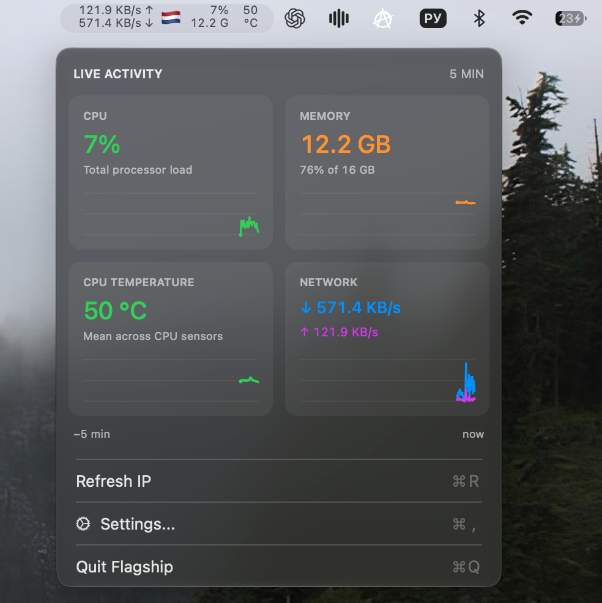
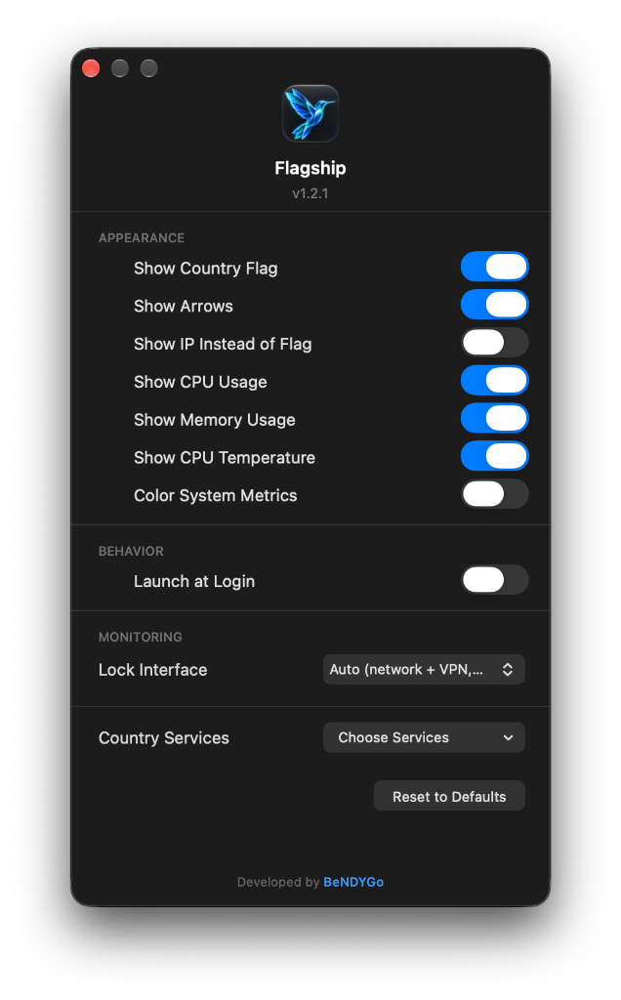

<p align="center">
  
</p>

# Flagship

[English](README.md) | [Русский](README-RU.md) | **简体中文** | [日本語](README-JA.md)

**Flagship** 是一款适用于 macOS 菜单栏的轻量、直观的系统监控工具。它将实时网络活动监控与关键系统指标（CPU 负载、内存使用量和 CPU 温度）完美结合。


|  |  |
| --- | --- |
|  |  |


## 主要功能

- **紧凑的菜单栏指示器**：双行显示当前上传和下载速度、国旗 / 外网 IP、CPU 占用、已用内存和 CPU 温度。
- **弹出式历史图表仪表盘**：提供每个指标最近 5 分钟的微线图历史记录（CPU、内存、温度以及合并的网络图表）。
- **国家/地区国旗与外网 IP 查询**：自动检测外网 IP 地理位置并显示国旗，网络或 VPN 切换时即时响应。
- **动态负载色彩提示**：根据负载级别（绿、黄、红）提供可自定义的颜色高亮，支持 macOS 浅色与深色外观模式。
- **高度可定制**：可随时隐藏任意不需要的指标（仅保留网络或仅保留系统状态）、锁定监控特定网络接口、自定义 Geo-IP 查询服务商。
- **极低资源占用**：基于原生 Swift/AppKit 构建，直接读取 SMC 传感器与 Mach 内核统计信息，无额外外部依赖。

---

## 安装说明

### 运行要求
- macOS 13.0 (Ventura) 或更高版本。
- 适用于 Apple Silicon (M1/M2/M3/M4) 和 Intel (x86_64) 的 Universal 通用二进制。

### 下载预编译版本
1. 从 [Releases](https://github.com/BeNDYGo/Flagship/releases) 页面下载 `Flagship.zip`。
2. 解压压缩包并将 `Flagship.app` 移动到 `/Applications`（应用程序）文件夹。
3. 启动应用，菜单栏中将出现指示器。
4. 点击指示器可查看仪表盘；在菜单中选择 **Settings...**（设置）以自定义外观并开启 **Launch at Login**（登录时启动）。

> **首次启动提示 (macOS Gatekeeper):**  
> 由于本应用采用本地 ad-hoc 签名且未购买苹果开发者证书，macOS 在首次打开时可能会提示未知开发者。
>
> 可通过以下 3 种方式打开：
> 1) 在访达 (Finder) 中右键点击（或按住 Control 点击）`Flagship.app`，然后选择 **打开**。
>
> 2) 如果仍然无法打开：前往 **系统设置** → **隐私与安全性** (Privacy & Security) → 向下滚动到 **安全性** (Security) 部分，点击 **仍要打开** (Open Anyway)。
>
> 3) 或者在终端中执行以下命令：  
> ```sh
> xattr -cr /Applications/Flagship.app
> ```

---

## 源码编译

如需自行编译本应用，需要安装 Xcode Command Line Tools。

1. 克隆代码仓库：
   ```sh
   git clone https://github.com/BeNDYGo/Flagship.git
   cd Flagship
   ```
2. 运行编译脚本：
   ```sh
   ./build.sh
   ```

该脚本将编译针对 `arm64` 与 `x86_64` 的通用二进制文件，打包应用并进行 ad-hoc 签名。成品文件位于 `build/Flagship.app`。

---

## 技术细节与架构实现

1. **菜单栏排版与布局**：采用固定的 9.5 pt regular 等宽数字字体（`monospacedDigitSystemFont`），避免数字变动时宽度抖动。已禁用自动缩窄——即使数值下降到个位数或零，预留宽度也保持稳定。隐藏部分指标时，其余指标会自动居中对齐。
2. **色彩阈值（Color System Metrics）**：启用后按阈值着色：CPU 在 50% 以下为正常颜色，50% 以上为橙色，80% 以上为红色；内存 在 70% 以下为正常颜色，70% 以上为警告色，90% 以上为危险色；CPU 温度 在 70°C 以下为正常颜色，70°C 以上为警告色，90°C 以上为危险色。调色板针对浅色和深色主题进行了自适应对比度优化。网络速度始终保持系统菜单栏的单色风格。
3. **后台资源采样**：所有测量均在独立的串行后台队列 `flagship.system`（`qos: .utility`）上以每秒一次的频率执行，绝不阻塞主 UI 线程。
4. **内存统计公式**：已用内存通过 `host_statistics64` 计算为 `active + wired + compressed`（1 GB = 1024³ 字节）。这反映的是实际占用的物理内存，而非合成的内存压力百分比。
5. **CPU 温度采样**：通过 IOKit 直接从 `AppleSMC` 驱动读取。数值代表当前采样中所有可用 CPU 核心热敏传感器的算术平均值（支持 Apple Silicon 和 Intel）。如果传感器不可用（例如在虚拟机中），则显示短划线。
6. **网络流量统计与 VPN 处理**：在 Auto（自动）模式下，监控器仅统计物理网卡（`en*`、`pdp_ip*`）。虚拟隧道接口（`utun*`）被排除在总和之外，因为 VPN 数据包在物理上已经经过了主网卡（这避免了速率翻倍的问题）。手动锁定到具体 `utun*` 时，仅统计该隧道的独立流量。
7. **网络速率计算精度**：速率基于两次采样之间的字节增量除以实际流逝的天文时间（`uptimeNanoseconds`）计算，而不是假设固定的 1.000 秒计时器间隔。新增接口接入时会先记录基准快照以消除速率虚高突增；锁定的接口断开时速率直接置零。
8. **网络变动感知**：结合了 `SCDynamicStore` 事件通知（全局 IPv4/IPv6 路由变更、服务状态、链路变动）、`NWPathMonitor`、每秒地址轮询以及系统唤醒事件（`didWakeNotification`）。
9. **Geo-IP 容错与重试机制**：网络发生变动时立即发起查询，并在 1 秒和 3 秒后执行二次验证，以便准确捕捉 VPN 的延迟路由切换。支持五个服务提供商（`ip-api.com`、`ipapi.co`、`api.country.is`、`ipinfo.io`、`ipwho.is`），并妥善处理 HTTP 429 和 `Retry-After` 限流头。在查询中或服务不可用时显示白旗 🏳️。
10. **数据持久化与历史记录**：5 分钟的历史图表数据仅保存在运行内存中，应用重启时自动重置。应用配置保存在独立的 `local.flagship.app` 域中，不与其他软件产生冲突。

---

## 来源与许可

- 基于 [NetBar](https://github.com/mh-sudo) (MIT License)。
- 许可证：MIT。
