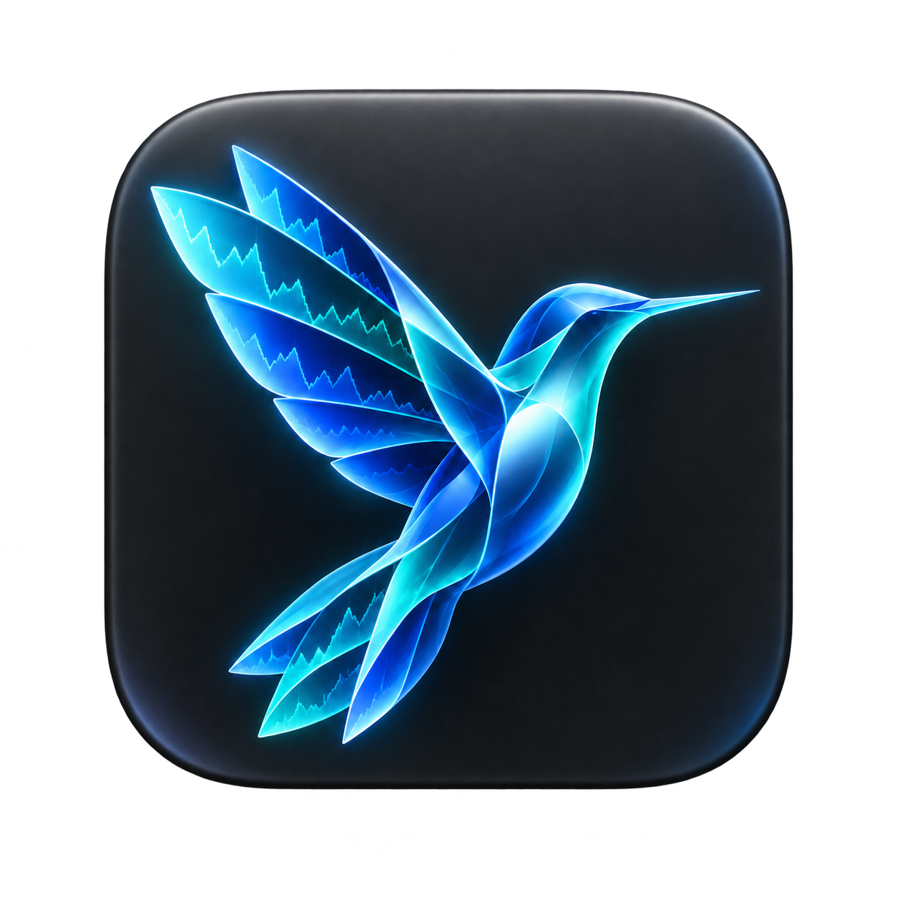
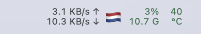
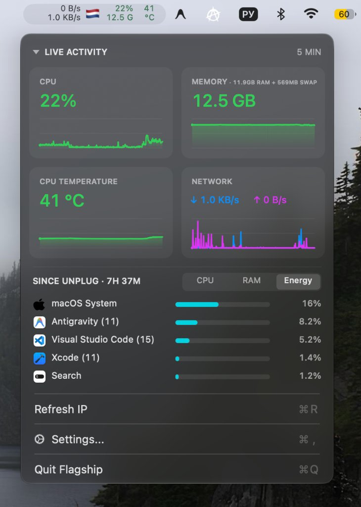
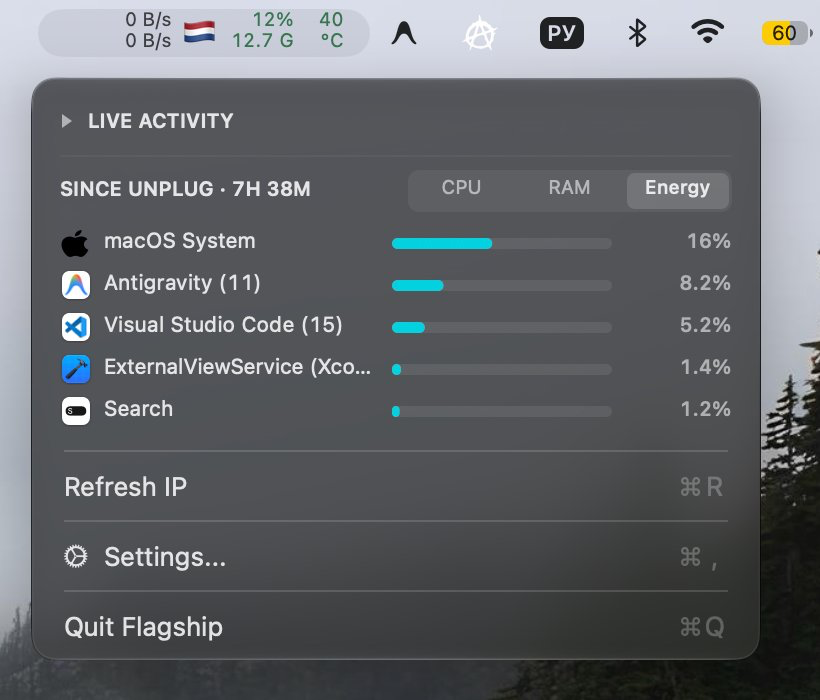
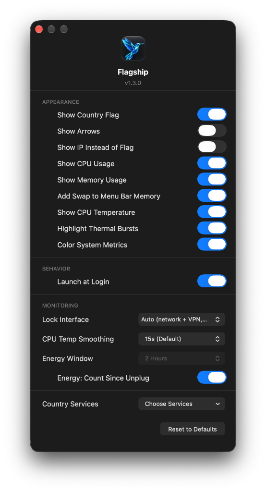

<div align="center">
  
  <h1>Flagship</h1>

  <p>
    <a href="https://github.com/BeNDYGo/Flagship/releases"></a>
    <a href="https://www.apple.com/macos/"></a>
    
    <a href="https://swift.org"></a>
    <a href="LICENSE"></a>
  </p>

  <p>
    <b>English</b> |
    <a href="README-RU.md">Русский</a>
  </p>

  <p>
    <b>Flagship</b> is a lightweight, informative system monitor for the macOS menu bar. The application combines real-time network activity monitoring, core system metrics (CPU load, RAM with Swap, CPU temperature), and a detailed process activity and battery drain tracker.
  </p>

  <p>
    
  </p>
</div>

| Full Dashboard | Compact Mode (Live Activity Collapsed) | Flagship Settings |
| :---: | :---: | :---: |
|  |  |  |


## Key Features

- **Compact menu bar indicator**: Two-line display showing current upload and download speeds, country flag / external IP, CPU load, used RAM (with optional Swap inclusion), and temperature.
- **Pop-up metrics dashboard**: 5-minute historical sparkline graphs for each metric (CPU, RAM, temperature, and combined network graph).
- **Collapsible Live Activity tiles**: One-click collapsible graph section to instantly switch into a compact process monitor view.
- **Top processes and battery drain tracking**: Monitor resource-intensive applications by CPU, RAM, and Energy. The **Energy** tab with **Since Unplug** mode calculates battery discharge percentage per app since disconnection from power, grouping background macOS system daemons.
- **Country flag and external IP lookup**: Automatic geolocation detection with country flag display, reacting instantly to network and VPN changes.
- **Dynamic load coloring**: Configurable color-coded metrics based on load level (green, yellow, red) supporting both light and dark macOS appearance modes.
- **Flexible customization**: Hide unwanted metrics, pin monitoring to a specific network interface, configure CPU Temp Smoothing, highlight thermal bursts, and select Geo-IP providers.
- **Minimal resource footprint**: Native Swift/AppKit application querying SMC sensors and Mach kernel statistics directly without external dependencies.

---

## Installation

### Requirements
- macOS 13.0 (Ventura) or later.
- Universal binary for Apple Silicon (M1/M2/M3/M4) and Intel (x86_64).

### Downloading Pre-built App
1. Download `Flagship.dmg` (or `Flagship.zip`) from the [Releases](https://github.com/BeNDYGo/Flagship/releases) page.
2. Open `Flagship.dmg` and drag `Flagship.app` into your `/Applications` folder.
3. Launch the app. The indicator will appear in your menu bar.
4. Click the indicator to view the dashboard. Use **Settings...** in the menu to customize appearance and enable **Launch at Login**.

> **Note on First Launch (macOS Gatekeeper):**  
> Because this application uses an ad-hoc local signature without a paid Apple Developer certificate, macOS may warn you on first launch.
>
> **Ways to open the app:**
> 1) Run in Terminal (fastest and most reliable method for all versions, including macOS 15 Sequoia):  
> ```sh
> xattr -cr /Applications/Flagship.app
> ```
> 2) Or go to **System Settings** → **Privacy & Security** → scroll down to the **Security** section and click **Open Anyway**.
> 3) On older macOS versions: right-click (or Control-click) `Flagship.app` in Finder and select **Open**.

---

## Building from Source

To build the application yourself, you will need Xcode Command Line Tools.

1. Clone the repository:
   ```sh
   git clone https://github.com/BeNDYGo/Flagship.git
   cd Flagship
   ```
2. Build the application (`.app`):
   ```sh
   ./build.sh
   ```
   The script compiles a universal binary for `arm64` and `x86_64`, packages the bundle, and ad-hoc signs it. The compiled application will be generated at `build/Flagship.app`.

3. *(Optional)* Build the disk image installer (`.dmg`):
   ```sh
   ./create-dmg.sh
   ```
   The script verifies `build/Flagship.app` (running `build.sh` if needed), attaches the `/Applications` shortcut, and generates a compressed `build/Flagship.dmg` disk image.

---

## Technical Details and Architecture

1. **Menu bar typography and layout**: Uses a fixed 9.5 pt regular font (`monospacedDigitSystemFont`) to avoid indicator jitter when digits change. Automatic narrowing is disabled — reserved width remains consistent even when numbers drop to single digits or zeros. Remaining metrics are automatically centered when others are hidden.
2. **Color thresholds (Color System Metrics)**: When enabled, colors are assigned based on thresholds: CPU is normal up to 50%, orange from 50%, red from 80%; RAM is normal up to 70%, warning from 70%, critical from 90%; CPU temperature is normal up to 70°C, warning from 70°C, critical from 90°C. Palette is dynamically adjusted for contrast across light and dark themes. Network speeds always maintain the system monochrome menu bar color.
3. **Background resource sampling**: All polling runs once per second on a dedicated serial background queue `flagship.system` (`qos: .utility`), never blocking the main UI thread.
4. **RAM and Swap measurement formula**: Used memory is calculated as `active + wired + compressed` from `host_statistics64` (1 GB = 1024³ bytes). The *Add Swap to Menu Bar Memory* setting reads active swapfile usage via `sysctl` (`vm.swapusage`).
5. **CPU temperature sampling and smoothing**: Read directly through IOKit from the `AppleSMC` driver. Features a moving average filter (CPU Temp Smoothing up to 60 seconds) to mitigate short thermal spikes, alongside a Highlight Thermal Bursts indicator.
6. **Process and Energy tracking**: Aggregates CPU load, physical RAM allocation, and power drain deltas using IOKit (`IOPMPowerSource`). In *Since Unplug* mode, app energy consumption is tracked against total battery drain. Helper processes, including system WebKit and video services, are grouped with their responsible application using the dynamically loaded private macOS API `responsibility_get_pid_responsible_for_pid`. No additional user permission is required; if the API or application owner is unavailable, grouping falls back to bundle and executable paths. Remaining macOS system daemons are consolidated under the unified `macOS System` item. Previously recorded energy history retains its original attribution.
7. **Network accounting and VPN handling**: In Auto mode, the monitor tallies only physical adapters (`en*`, `pdp_ip*`). Virtual tunnel interfaces (`utun*`) are excluded from the total to prevent double-counting traffic already routed through the physical adapter. When an interface is locked manually to a specific `utun*`, only that tunnel's traffic is counted.
8. **Speed measurement accuracy**: Speeds are calculated using the byte delta divided by actual elapsed astronomical time (`uptimeNanoseconds`), rather than assuming a precise 1.000-second timer interval. When a new interface appears, a baseline snapshot is taken first to prevent artificial speed spikes. If a locked interface disconnects, speed immediately drops to zero.
9. **Network change detection**: Combines `SCDynamicStore` notifications (global IPv4/IPv6 routing shifts, service state, link changes), `NWPathMonitor`, 1-second address polling, and system wake events (`didWakeNotification`).
10. **Geo-IP failover and rate limits**: On network change, an immediate lookup is fired, followed by verification retries after 1 and 3 seconds to catch delayed VPN routing. Five providers are supported (`ip-api.com`, `ipapi.co`, `api.country.is`, `ipinfo.io`, `ipwho.is`), handling HTTP 429 and `Retry-After` headers gracefully. A white flag 🏳️ is displayed while checking or when services are unreachable.
11. **Data persistence and history**: The 5-minute historical graph data is stored strictly in volatile RAM and is reset upon app restart. Settings are saved under the isolated bundle domain `local.flagship.app` without conflicting with other tools.

---

## Origin and License

- Based on: [NetBar](https://github.com/mh-sudo) (MIT License).
- License: MIT.
